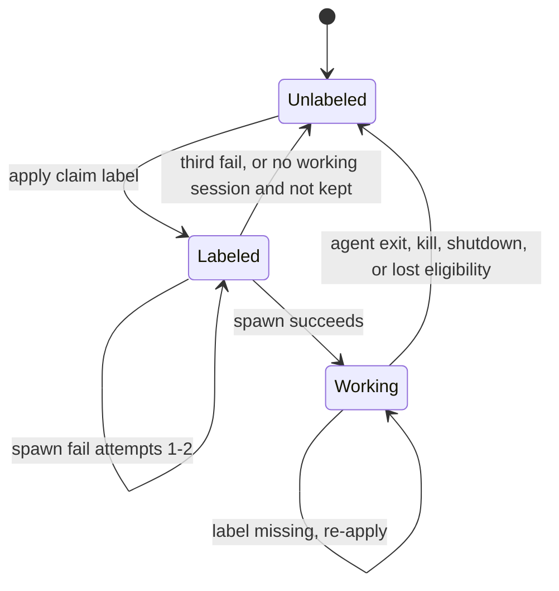
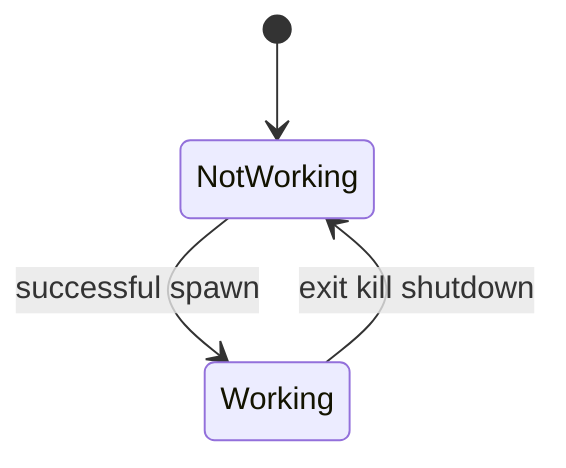

# ADR 007: Orchestration cycle and claim/session state machine

## Status

Accepted

Supersedes [007](007-orchestration-cycle-and-claim-session-state-machine.md).

## Context

Feature [05](../feature/05-agent-orchestration.md) defines claim-then-spawn, swarm-fit, caps, 1:0–1 mapping, and three-strike spawn failures. The claim is the remote claim label. Intake ([06](../feature/06-work-intake-and-issue-monitoring.md), [009-1](009-1-intake-poll-and-delta.md)) supplies the intake set and which open issues carry the label. Local state ([02](../feature/02-local-state.md), [004-1](004-1-local-state-format-and-process-lock.md)) stores sessions and spawn failures, not claims. Component design needs one cycle order and explicit state machines.

## Decision

### Poll cycle sequence (main loop)

Each tick after bootstrap (interval = `poll_interval_seconds`):

1. If shutting down → skip (no new work).
2. **Intake fetch + delta** ([009-1](009-1-intake-poll-and-delta.md)). On issue-fetch failure → log and dashboard error; keep the last good snapshot; skip label changes driven by intake. Still run step 3. The babysitter fetch is step 8 and fails separately.
3. **Reconcile working sessions** — observe ACP exits. Issue-session exit → remove the claim label, remove the worktree, mark not working. Babysitter exit → remove the worktree, mark not working, no label change.
4. **Reconcile remote labels**
   - Working session, label missing → re-apply the label. Do not stop.
   - Working session, issue closed, not intake, or no longer matching that session's agent → stop the session and remove the label.
   - No working session and label absent → the issue is not claimed. Do not apply a label from local memory.
   - No working session, label present, and the issue is closed, not intake, matches no configured agent, or already has three spawn failures → remove the label.
5. **Count caps from working issue sessions.** Those sessions stay. Do not stop one to prefer a lower issue number. Babysitter sessions are outside the caps.
6. **Fulfill labeled issues** that have no working session, still match an agent, and are under the three-strike limit. Ascending issue number. Assign the earliest `agents[]` entry that matches and still has per-agent and global room. Spawn (the label is already present). Stop when room is gone. Remove the label from labeled issues that were not assigned.
7. **Claim then spawn new matches** in the remaining room. Ascending issue number. Same agent rule: the earliest matching agent with room. An earlier agent already at its cap does not reserve the issue. Apply the label, then spawn. Spawn until the caps are full.
8. **Babysitter step** when enabled ([010-1](010-1-pr-babysitter-lifecycle.md)). A failed PR fetch skips only this step.
9. Persist session and spawn-failure updates as they happen. A session is `working` only after a successful spawn.

### Identities

- **Config identity**: stable `agents[].id` / `babysitter.id`.
- **Session identity**: generated per spawn; one issue **or** one PR; never both.
- **Claim**: the remote claim label. No local claim record.

### Label and session states (issue)

Notes:

- `Labeled` with no working session is normal after restart and between spawn retries. The label on the tracker is what makes it labeled.
- A working session is kept when caps are tight.
- Spawn failure does not count as a session slot.
- Three consecutive failures are the spawn-failure records for that issue. The third removes the label. Success clears that issue's spawn-failure records. If those records already show three failures and the label is still present, remove the label and do not spawn.

### Session record states

On process start ([003-1](003-1-config-load-and-bootstrap-sequence.md) step 6), every session is forced `NotWorking` after reload and before the first cycle.

### Caps

- Per-agent `max_concurrent_sessions` and global `max_concurrent_sessions` count **working issue sessions**. A spawn that fails does not occupy a slot. The babysitter is excluded.
- Defaults are 1 / 1 from the config schema.
- Room for a new or recovered spawn is what remains after working issue sessions.

### Ordering summary

| Action | Order |
|--------|-------|
| Keep working sessions | Always, including when a lower issue number is labeled |
| Fulfill labeled issues with no working session | Ascending issue number; earliest agent with room |
| New trigger matches | Ascending issue number; earliest agent with room |
| Remove excess labels with no working session | Descending issue number |

## Reasoning

- A single ordered cycle keeps label-then-spawn ahead of a second starter and matches feature 05 (labeled issues before new matches).
- The tracker is the claim status, so a local claim record would be free to disagree with it.
- Keeping a working session matches the operator's choice: running work is not stopped to prefer a lower issue number.
- Filling remaining room with the earliest agent that has room, up to the caps, matches agents exiting on their own when they finish. A busy earlier agent does not block a later match.
- Spawn-failure records are the attempt memory feature 02 already stores.

## Rejected alternatives

| Alternative | Why not |
|-------------|---------|
| Spawn then claim | Another Orkie or human could race; feature requires label then spawn |
| Encode agent or session id in the claim label | The label stays a single opaque mark. The session binds the agent |
| Local claim record | A second claim status. Feature 05 reads the tracker only |
| Orchestrator decides completion | The agent exits when it finishes; exit removes the label |
| Reserve an issue for an at-cap earlier agent | Leaves capacity unused while another matching agent has room |
| Stop a working session so a lower issue number can run | Running work stays |
| Parallel spawn without cap accounting | Would violate global and per-agent ceilings |

## Consequences for design

- `orkie.orchestration` is the only module that applies or removes claim labels and decides spawns.
- Dashboard kill calls orchestration, so label removal stays in this cycle's rules.
- Offline tests drive a fake connector and a fake ACP through one cycle and assert label and session transitions.
- Worktree create and remove bookend Working ([008-1](008-1-git-worktrees.md)).
