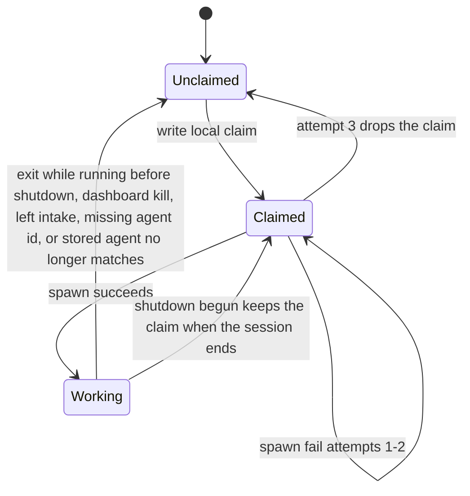

# ADR 007: Orchestration cycle and claim/session state machine

## Status

Accepted

Supersedes [007-1](superseded/007-1-orchestration-cycle-and-claim-session-state-machine.md).

## Context

Feature [05](../feature/05-agent-orchestration.md) defines claim-then-spawn, caps, 1:0–1 mapping inside Orkie, and three-strike spawn failures. A claim is a local record. Intake ([06](../feature/06-work-intake-and-issue-monitoring.md), [009-2](009-2-intake-poll-and-delta.md)) supplies the current intake set and delta. Local state ([02](../feature/02-local-state.md), [004-2](004-2-local-state-format-and-process-lock.md)) stores claims, sessions, and spawn failures. Component design needs one cycle order and explicit state machines.

## Decision

### Poll cycle sequence (main loop)

Each tick after bootstrap (interval = `poll_interval_seconds`):

1. If shutting down → skip (no new work).
2. **Intake fetch + delta** ([009-2](009-2-intake-poll-and-delta.md)). On issue-fetch failure → log and dashboard error; keep the last good snapshot; do not change claims because of the fetch; skip steps 4–7. Still run step 3. Step 8 runs only when the PR fetch succeeded.
3. **Observe ACP exits.** An issue-session exit while Orkie is running and shutdown has not started drops that local claim, removes the worktree, and deletes the session record. Once `shutdown_event` or the interactive shutdown-prompt flag is set, an observed exit does not drop the claim ([011-2](011-2-cli-signals-and-process-lifecycle.md)). A babysitter exit removes the worktree and deletes the session record. No claim is involved.
4. **Drop claims that no longer apply.** On a successful issue fetch, scan every saved claim against the current intake set and config (do not rely only on delta kinds): if `issue_number` is not in the intake set, or `agent_id` is absent from `agents[]`, or that agent no longer matches the issue → stop a live session on it (delete path, [006-1](006-1-acp-agent-runtime.md)), drop the claim, remove the worktree. A claim dropped here because the agent no longer matches (including a missing config id) may be written again in step 7 for a different matching agent, unless a spawn-failure row for that issue has `attempt` 3. Leaving intake does not clear spawn-failure rows.
5. **Count caps from working issue sessions.** Those sessions stay. Do not stop one to prefer a lower issue number. Queued claims do not consume a cap. Babysitter sessions are outside the caps.
6. **Fulfill saved claims** that have no live session, whose stored agent still matches, and that are under the three-strike limit. Ascending issue number. Spawn that stored agent. If that agent is at its cap, or the global cap is full, the claim waits even when another agent has room. Stop when room is gone. Do not drop a claim only because the cap is full.
7. **Claim then spawn new matches** in the remaining room. Ascending issue number. The agent is the earliest `agents[]` entry that matches and still has room. An earlier agent already at its cap does not reserve the issue. Write the local claim, then spawn. Skip issues that already have a claim or a spawn-failure row with `attempt` 3. Spawn until the caps are full.
8. **Babysitter step** when enabled and the PR fetch succeeded ([010-2](010-2-pr-babysitter-lifecycle.md)). A failed PR fetch skips only this step.
9. Persist claim, snapshot, and spawn-failure updates **as each step mutates them** (not a deferred batch at cycle end). A session is `working` only after a successful spawn.

Orchestration mints one UUID4 `session_id` per spawn and passes it to worktree create, prompt substitution, and `acp.spawn` ([006-1](006-1-acp-agent-runtime.md)).

### Identities

- **Config identity**: stable `agents[].id` / `babysitter.id`.
- **Session identity**: minted per spawn by orchestration; one issue **or** one PR; never both. Not stored on the claim.
- **Claim**: local `{agent_id, issue_number, claimed_at}`. At most one per issue.

### Claim states (issue)

Notes:

- `Claimed` with no working session is normal after restart, while queued for a cap, and between spawn retries.
- A working session is kept when caps are tight.
- Spawn failure does not count as a session slot.
- Three consecutive failures append spawn-failure rows. Attempt 3 sets `released`, drops the claim, and writes no fourth row. While any row for that issue has `attempt` 3, steps 6 and 7 do not spawn it. Success clears that issue's rows.
- A stored `agent_id` missing from config is treated as no longer matching (step 4).
- Persist claim, snapshot, and spawn-failure updates on each mutation (step 9), not as a deferred batch at cycle end.

### Session record

A session record exists only while the session is live in this process. Startup deletes leftovers. Shutdown deletes them. There is no resumed `working=false` session.

### Caps

- Per-agent `max_concurrent_sessions` and global `max_concurrent_sessions` count **working issue sessions**. A spawn that fails does not occupy a slot. The babysitter is excluded.
- Defaults are 1 / 1 from the config schema.
- Room for a spawn is what remains after working issue sessions.

### Dashboard kill

Kill uses the ACP delete path and, for an issue session, drops the local claim in this cycle's rules so the next poll does not respawn from that claim. Interrupt keeps the session and the claim.

### Ordering summary

| Action | Order |
|--------|-------|
| Keep working sessions | Always, including when a lower issue number is queued |
| Fulfill saved claims with no live session | Ascending issue number; the agent stored on the claim |
| New trigger matches | Ascending issue number; earliest agent with room |

## Reasoning

- A single ordered cycle keeps claim-then-spawn ahead of a second assignment and matches feature 05 (saved claims before new matches).
- The local claim is the assignment the next start spawns from. GitHub is not a second claim status.
- Fulfillment uses the stored agent so a claim cannot move to whoever has room.
- Keeping a working session matches feature 05: running work is not stopped to prefer a lower issue number.
- Spawn-failure records are the attempt memory feature 02 already stores.

## Rejected alternatives

| Alternative | Why not |
|-------------|---------|
| Spawn then claim | A crash between them would leave a session with no assignment. Feature 05 writes the claim first |
| Key the claim by session id | The session is discarded on shutdown. The claim has to outlive it |
| Remote claim label | Feature 05: the claim is local. Two parties on one GitHub issue are acceptable |
| Drop queued claims when the cap is full | They wait. The cap counts working sessions |
| Stop a working session so a lower issue number can run | Running work stays |
| Fulfill a claim with a different agent that has room | The claim names its agent. A trigger change drops the claim first |
| Orchestrator decides completion | The agent exits when it finishes; exit while running drops the claim |
| Resume the previous ACP session after restart | Feature 04: a new spawn is a new session |
| Clear three-strike rows when the issue leaves intake | Feature 05: only a successful spawn clears them |

## Consequences for design

- `orkie.orchestration` is the only module that writes or drops claims and decides spawns.
- Dashboard kill calls orchestration, so claim drop stays in this cycle's rules.
- Offline tests drive a fake connector and a fake ACP through one cycle and assert claim and session transitions.
- Worktree create and remove bookend a live session ([008-1](008-1-git-worktrees.md)).
