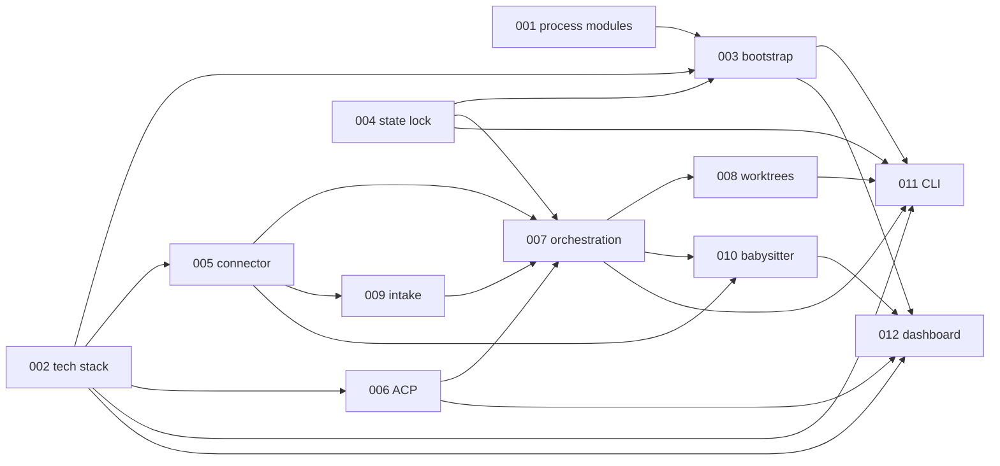

# Orkie Architecture Decision Records

ADRs lock design decisions that [feature specs](../feature/) leave open. Features own product behavior (stories, acceptance criteria). ADRs own how Orkie is structured, which flows and state machines implement that behavior, and which frameworks and libraries are used.

## Coverage criteria

The full ADR set must:

1. **Satisfy all features** — every numbered feature in [`spec/feature/`](../feature/) is covered by one or more ADRs (see [Feature coverage](#feature-coverage)).
2. **Inform component design** — together, ADRs are detailed and consistent enough to design packages, modules, flows, states, and sequences without inventing unstated architecture.
3. **Cover the tech stack** — approved dependencies, stdlib-first choices, explicitly rejected libraries, and offline test / coverage standards appear in the set (especially [002](002-1-tech-stack-and-dependencies.md)).

## General principles

When defining or revising an ADR:

1. **Keep it simple.** Prefer the fewest components, interactions, and third-party libraries that still achieve the feature goals. Reject options that add moving parts without a clear need from the specs.
2. **Configurability only when the feature demands it.** Do not invent knobs, modes, or pluggable surfaces in an ADR unless a feature spec requires that variability. Fixed, boring defaults beat speculative flexibility.

Apply these when choosing among alternatives and when writing Consequences for design.

## Relationship to features

| Layer | Owns |
|-------|------|
| [`spec/feature/`](../feature/) | What Orkie does for users; vocabulary; acceptance criteria |
| [`spec/adr/`](./) | How Orkie is built: process model, modules, sequences, libraries |
| [`spec/design/`](../design/) | Implementable detail: interfaces, schemas, UI, config shape |

ADRs cite owning features. They do not restate acceptance criteria. When product behavior changes, update the feature first, then the owning ADR, then [design](../design/) when implementable detail changes.

Companion feature docs: [vocabulary](../feature/vocabulary.md), [users](../feature/users.md), [dependencies](../feature/dependencies.md).

## Document shape

Every ADR file uses the same sections (lean, feature-spec style):

1. **Status** — `Proposed` / `Accepted` / `Superseded` (superseded files live under [`superseded/`](superseded/); link successor ↔ predecessor in Status)
2. **Context** — why a decision is needed; link features
3. **Decision** — what we chose, including libraries and APIs when relevant
4. **Reasoning** — why
5. **Rejected alternatives** — notable options and why not
6. **Consequences for design** — modules, flows, states, and sequences this ADR implies

## Naming and layout

- **Current ADRs** live directly under [`spec/adr/`](./). Only `Proposed` or `Accepted` files belong here (plus this README).
- **New decision:** `NNN-short-kebab-title.md` (three-digit sequence). Example: `001-process-model-and-module-layout.md`.
- **Supersession:** keep the **same** `NNN` and append a revision suffix `-1`, `-2`, … before the title. Do **not** mint a new sequence number for a replacement.
- **Superseded ADRs** move to [`superseded/`](superseded/). They keep their filename. The previous current file is moved there when its successor is accepted; it does not remain beside the current file in `spec/adr/`.

| Role | Location | Example |
|------|----------|---------|
| Original (then `Superseded`) | `superseded/` | `superseded/002-tech-stack-and-dependencies.md` |
| First replacement (`Accepted`) | `spec/adr/` | `002-1-tech-stack-and-dependencies.md` |
| Second replacement | `spec/adr/` (prior `-1` moves to `superseded/`) | `002-2-….md` |

The catalog index lists only the **current** file for each `NNN`. Superseded files are not catalog rows; they stay readable under `superseded/` and are linked from Status.

### Linking

Anything under `spec/adr/*.md` (except history links) is current — link those files (or the [catalog](#catalog)). Do not link into `superseded/` except for Status history (“Supersedes …” / “Superseded by …”). After a supersession, move the old file into `superseded/`, point Status both ways, update the catalog row, and fix outbound links in other current ADRs and docs.

## Catalog

| ID | Title | Status | Features |
|----|-------|--------|----------|
| [001](001-2-process-model-and-module-layout.md) | Process model and module layout | Accepted | All; esp. 05, 08 |
| [002](002-1-tech-stack-and-dependencies.md) | Tech stack and dependencies | Accepted | All |
| [003](003-2-config-load-and-bootstrap-sequence.md) | Config load and bootstrap sequence | Accepted | 01, 03, 08 |
| [004](004-2-local-state-format-and-process-lock.md) | Local state format and process lock | Accepted | 02, 08 |
| [005](005-2-connector-interface-and-github-client.md) | Connector interface and GitHub client | Accepted | 03, 06, 07 |
| [006](006-1-acp-agent-runtime.md) | ACP agent runtime | Accepted | 04, 05 |
| [007](007-2-orchestration-cycle-and-claim-session-state-machine.md) | Orchestration cycle and claim/session state machine | Accepted | 05, 02, 06 |
| [008](008-1-git-worktrees.md) | Git worktrees | Accepted | 05, 07 |
| [009](009-2-intake-poll-and-delta.md) | Intake poll and delta | Accepted | 06, 02 |
| [010](010-2-pr-babysitter-lifecycle.md) | PR babysitter lifecycle | Accepted | 07, 05 |
| [011](011-2-cli-signals-and-process-lifecycle.md) | CLI, signals, and process lifecycle | Accepted | 08, 01 |
| [012](012-2-dashboard-stack-and-control-api.md) | Dashboard stack and control API | Accepted | 08, 04 |

### Feature coverage

| Feature | ADRs |
|---------|------|
| [01 Bootstrap and config](../feature/01-project-bootstrap-and-config.md) | 001, 002, 003, 011 |
| [02 Local state](../feature/02-local-state.md) | 001, 002, 004, 007, 009 |
| [03 Connector and GitHub](../feature/03-connector-interface-and-github.md) | 001, 002, 003, 005 |
| [04 ACP agent runtime](../feature/04-acp-agent-runtime.md) | 001, 002, 006, 012 |
| [05 Agent orchestration](../feature/05-agent-orchestration.md) | 001, 002, 006, 007, 008, 010 |
| [06 Work intake](../feature/06-work-intake-and-issue-monitoring.md) | 001, 002, 005, 007, 009 |
| [07 PR babysitter](../feature/07-pr-babysitter.md) | 001, 002, 005, 008, 010 |
| [08 CLI and dashboard](../feature/08-cli-and-dashboard.md) | 001, 002, 003, 004, 011, 012 |

Each row lists every ADR whose catalog entry cites the feature; 001 and 002 cite all features.

## Clarification and update rules

- **Clarify before drafting new ADRs.** New catalog entries are written only after Context, Decision, Rejected alternatives, and Consequences are agreed with the operator. Status starts as `Proposed` until accepted in that conversation.
- **Change the owning ADR** when a design decision changes. Keep this catalog and feature links current.
- **Supersede, do not silently rewrite.** When an Accepted decision's intent changes: write `NNN-<k>-….md` in `spec/adr/`, move the previous current file into `superseded/`, mark it `Superseded` with a link to the successor (and “Supersedes …” on the new file), leave the old text readable, and point the catalog row at the new file. Never assign the next free sequence (`013`, …) for a supersession.
- **Prefer extending an existing ADR** when the change belongs to the same decision boundary. Assign a **new sequence** (`NNN`) only for a distinct architectural choice that is not replacing an existing ADR.
