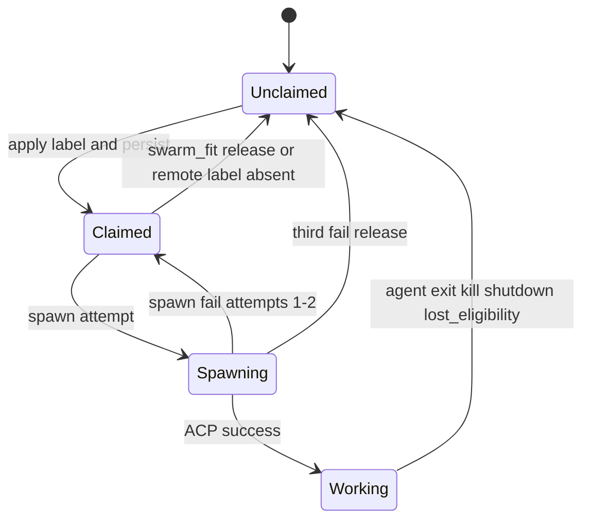
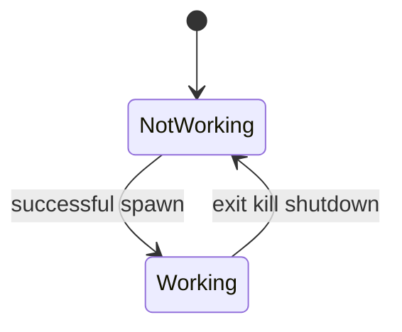

# ADR 007: Orchestration cycle and claim/session state machine

## Status

Superseded by [007-1](007-1-orchestration-cycle-and-claim-session-state-machine.md).

## Context

Feature [05](../../feature/05-agent-orchestration.md) defines claim-then-spawn, swarm-fit, caps, 1:0–1 mapping, and three-strike spawn failures. Intake ([06](../../feature/06-work-intake-and-issue-monitoring.md), [009](009-intake-poll-and-delta.md)) supplies deltas. Local state ([02](../../feature/02-local-state.md), [004](004-local-state-format-and-process-lock.md)) stores claims and sessions. Component design needs one cycle order and explicit state machines.

## Decision

### Poll cycle sequence (main loop)

Each tick after bootstrap (interval = `poll_interval_seconds`):

1. If shutting down → skip (no new work).
2. **Intake fetch + delta** ([009](009-intake-poll-and-delta.md)). On failure → log/dashboard error; skip orchestration mutations this tick; keep last good snapshot/claims.
3. **Reconcile working sessions** — observe ACP exits. Issue-session exit → release claim (label + local record). Babysitter exit → no claim work. Any exit → cleanup worktree and mark not working.
4. **Reconcile claims vs intake**
   - Closed / non-intake / lost trigger → stop session if any, release claim.
   - Working session missing claim label → re-apply label (do not stop).
   - Remote label rules for claims **without** a working session (startup and mid-run, e.g. the label was removed externally during a spawn-retry window): absent label → drop local claim; present + owner → swarm-fit; present + no owner → release. Working sessions always use the re-apply rule above.
5. **Swarm-fit release** — unknown agent, over per-agent or global cap when ordered; excess over-cap releases **highest issue numbers first**.
6. **Fulfill recovered claims** — ascending issue number; spawn only (label already present); respect caps; three-strike budget.
7. **Claim then spawn new matches** — remaining capacity; ascending issue number; if several agents match, earlier `agents[]` entry wins; apply label → persist claim (`spawn_attempts=0`) → spawn.
8. **Babysitter step** when enabled ([010](010-pr-babysitter-lifecycle.md)) — does not use issue caps/claims.
9. Persist session/claim/spawn-failure updates as they happen (claims at establish time).

### Identities

- **Config identity**: stable `agents[].id` / `babysitter.id`.
- **Session identity**: generated per spawn; one issue **or** one PR; never both.

### Claim record states (issue)

Notes:

- `Claimed` without `Working` is normal after restart and between spawn retries.
- Spawn failure does not count as a session slot.
- Successful spawn resets `spawn_attempts` to 0.
- A recovered claim persisted with `spawn_attempts` ≥ 3 (a crash between the third failure and its release) is released, not fulfilled.

### Session record states

On process start ([003](003-config-load-and-bootstrap-sequence.md) step 6), every session is forced `NotWorking` before the first cycle runs.

### Caps

- Per-agent `max_concurrent_sessions` and global `max_concurrent_sessions` count **working issue sessions** (and in-flight spawns that will become working only after success—failed spawns free the slot). Babysitter excluded.
- Defaults are 1 / 1 from config schema.

### Ordering summary

| Action | Order |
|--------|-------|
| Fulfill recovered claims | Ascending issue number |
| New trigger matches | Ascending issue number; agent list order on ties |
| Release excess over-cap | Descending issue number |

## Reasoning

- A single ordered cycle prevents claim races (label before spawn) and matches feature 05 recovery-before-new-match rules.
- Separating claim state from working state matches feature 02 and restart semantics.
- Explicit three-strike and swarm-fit release prevent stuck `orkie:claimed` labels.

## Rejected alternatives

| Alternative | Why not |
|-------------|---------|
| Spawn then claim | Another Orkie or human could race; feature requires claim then spawn |
| Encode agent/session id in the claim label | Feature: single opaque claim label; owner lives in local state |
| Orchestrator decides completion | Feature: agent decides stop; exit releases claim |
| Parallel spawn without cap accounting | Would violate global/per-agent ceilings |

## Consequences for design

- `orkie.orchestration` is the only module that applies/removes claim labels and decides spawns.
- Dashboard kill calls orchestration, not ACP alone, so claim release stays centralized.
- Offline tests drive a fake connector + fake ACP through one cycle and assert label/record transitions.
- Worktree create/remove bookend Working ([008](008-git-worktrees.md)).
