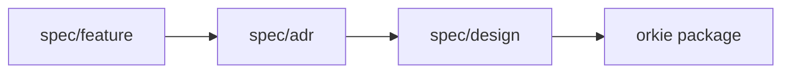

# Orkie Design

Design sits between product behavior and code. Features say what Orkie does. ADRs lock architecture and libraries. These documents specify the implementable shape: components, sequences, data, UIs, and config — detailed enough that writing v1 code requires no guesswork.

## Principles

1. **Simple.** Prefer the fewest components, interactions, and integrations that still satisfy the features. Do not invent packages, knobs, or services beyond the ADR [001](../adr/001-2-process-model-and-module-layout.md) package map and the knobs required by feature [01](../feature/01-project-bootstrap-and-config.md).
2. **No guesswork.** Every public function signature, JSON field, HTTP route, poll-cycle step, error path, and wire message needed to implement v1 is specified here or cited to a feature or ADR table. If something is missing, fix the design (or the owning feature/ADR) before coding.
3. **Traceable.** Each design file lists owning features and ADRs. Component sections name the stories they satisfy. Do not restate full acceptance criteria; link to features. Do not reopen ADR alternatives.

## Layers

| Layer | Owns |
|-------|------|
| [`spec/feature/`](../feature/) | Product behavior, stories, acceptance criteria, vocabulary |
| [`spec/adr/`](../adr/) | Process model, modules, libraries, locked flows |
| [`spec/design/`](./) | Implementable interfaces, schemas, sequences, UI, config shape, coding conventions |
| Code | Implementation that matches this design and its [conventions](conventions.md) |

## Catalog

| File | Contents |
|------|----------|
| [components.md](components.md) | Purpose, scope, interfaces, lifecycle per package (ADR 001 order) |
| [sequences.md](sequences.md) | Happy-path diagrams; unhappy flows and retries as notes |
| [data.md](data.md) | On-disk and in-memory structures, ownership, readers |
| [ui.md](ui.md) | CLI surface and dashboard pages, navigation, CTAs |
| [config.md](config.md) | Configurable fields, YAML shape, defaults, precedence |
| [conventions.md](conventions.md) | How to write the package: layering, static control flow, pure decisions, test seams |

## Reading order

1. [config.md](config.md) — what projects declare
2. [components.md](components.md) — module boundaries and APIs
3. [data.md](data.md) — what is stored where
4. [sequences.md](sequences.md) — who calls whom
5. [ui.md](ui.md) — operator and dashboard surfaces
6. [conventions.md](conventions.md) — how to implement the package

Companion product docs: [vocabulary](../feature/vocabulary.md), [users](../feature/users.md), [dependencies](../feature/dependencies.md). ADR catalog: [spec/adr/README.md](../adr/README.md).

## Feature coverage

| Feature | Design files |
|---------|--------------|
| [01 Bootstrap and config](../feature/01-project-bootstrap-and-config.md) | config, components (`cli`, `config`), sequences (bootstrap), ui (CLI prompts) |
| [02 Local state](../feature/02-local-state.md) | data, components (`state`) |
| [03 Connector and GitHub](../feature/03-connector-interface-and-github.md) | components (`connectors`), sequences (bootstrap privileges), config (`connector`) |
| [04 ACP agent runtime](../feature/04-acp-agent-runtime.md) | components (`acp`), sequences (spawn/interrupt/kill), data (session handle) |
| [05 Agent orchestration](../feature/05-agent-orchestration.md) | components (`orchestration`, `worktree`), sequences (cycle, claim-spawn), data |
| [06 Work intake](../feature/06-work-intake-and-issue-monitoring.md) | components (`intake`), sequences (poll), data (snapshot) |
| [07 PR babysitter](../feature/07-pr-babysitter.md) | components (`orchestration`), sequences (babysitter), data |
| [08 CLI and dashboard](../feature/08-cli-and-dashboard.md) | ui, components (`cli`, `dashboard`), sequences (shutdown) |

[conventions.md](conventions.md) applies to the implementation of every feature.

## ADR coverage

| ADR | Design files |
|-----|--------------|
| [001 Process and modules](../adr/001-2-process-model-and-module-layout.md) | components, conventions, README |
| [002 Tech stack](../adr/002-2-tech-stack-and-dependencies.md) | components, config, ui, conventions |
| [003 Bootstrap](../adr/003-3-config-load-and-bootstrap-sequence.md) | sequences, components (`cli`, `config`), config |
| [004 Local state](../adr/004-2-local-state-format-and-process-lock.md) | data, components (`state`) |
| [005 Connector](../adr/005-2-connector-interface-and-github-client.md) | components (`connectors`) |
| [006 ACP](../adr/006-1-acp-agent-runtime.md) | components (`acp`), sequences |
| [007 Orchestration cycle](../adr/007-2-orchestration-cycle-and-claim-session-state-machine.md) | sequences, components (`orchestration`) |
| [008 Worktrees](../adr/008-1-git-worktrees.md) | components (`worktree`), data |
| [009 Intake](../adr/009-2-intake-poll-and-delta.md) | components (`intake`), sequences, data |
| [010 Babysitter](../adr/010-2-pr-babysitter-lifecycle.md) | sequences, components (`orchestration`) |
| [011 CLI / signals](../adr/011-2-cli-signals-and-process-lifecycle.md) | ui, sequences, components (`cli`) |
| [012 Dashboard](../adr/012-3-dashboard-stack-and-control-api.md) | ui, components (`dashboard`) |

## Locked design choices (beyond ADRs)

These were agreed for design and are normative for v1:

| Choice | Decision |
|--------|----------|
| Doc layout | Hybrid: concern files; `components.md` ordered by ADR 001 packages |
| Intake fetch failure | Skip orchestration steps 4–7 (claim drop for eligibility, cap count, fulfill saved claims, new claims). Still run step 3 (ACP exit reconcile, which may drop a claim when shutdown has not started). Babysitter step 8 only if the PR fetch succeeds. Persist mutations as they happen |
| Warn-only privilege probes | Empty in v1 — the probe list is the required set only ([005](../adr/005-2-connector-interface-and-github-client.md)) |
| ACP depth | Orkie `acp` module API **and** ACP JSON-RPC wire sequence Orkie uses (protocol version 2, newline-delimited stdio) |

## Update rules

1. **Product behavior changes** → update the owning feature first, then the owning ADR if architecture shifts, then this design.
2. **Architecture / library changes** → supersede or revise the ADR, then update design.
3. **Implementable detail only** (signatures, field shapes already implied by features/ADRs) → update design; cite the feature/ADR.
4. Keep the coverage matrices in this README current when files are added or ownership moves.
5. Prefer extending an existing design section over adding a new component.
