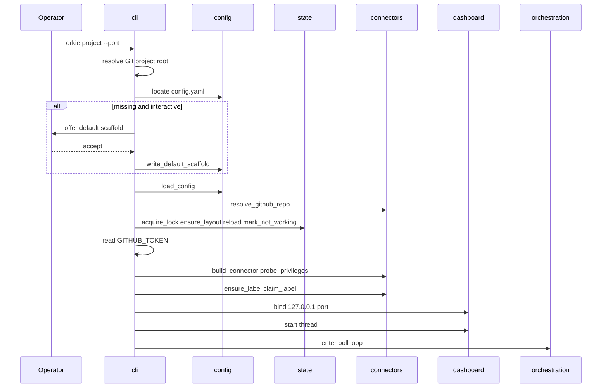
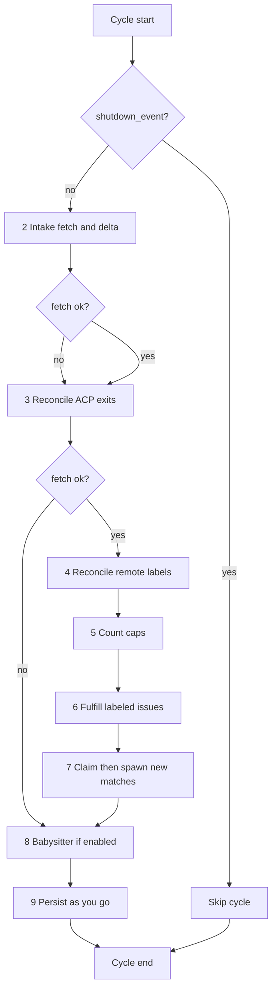
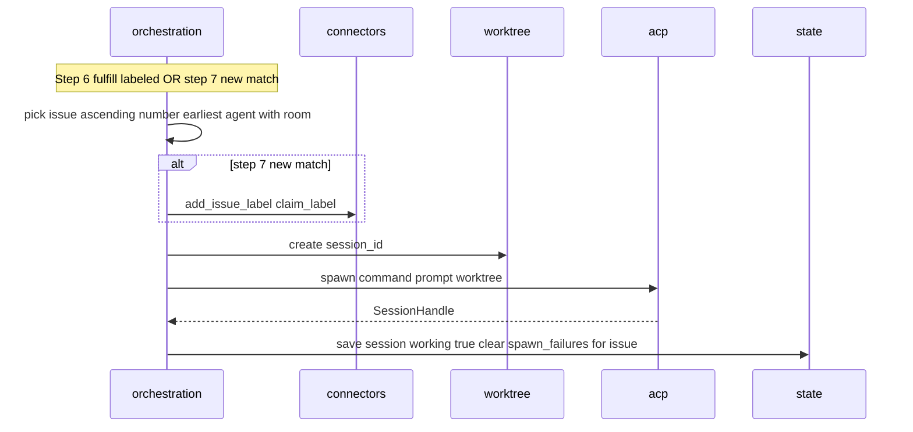
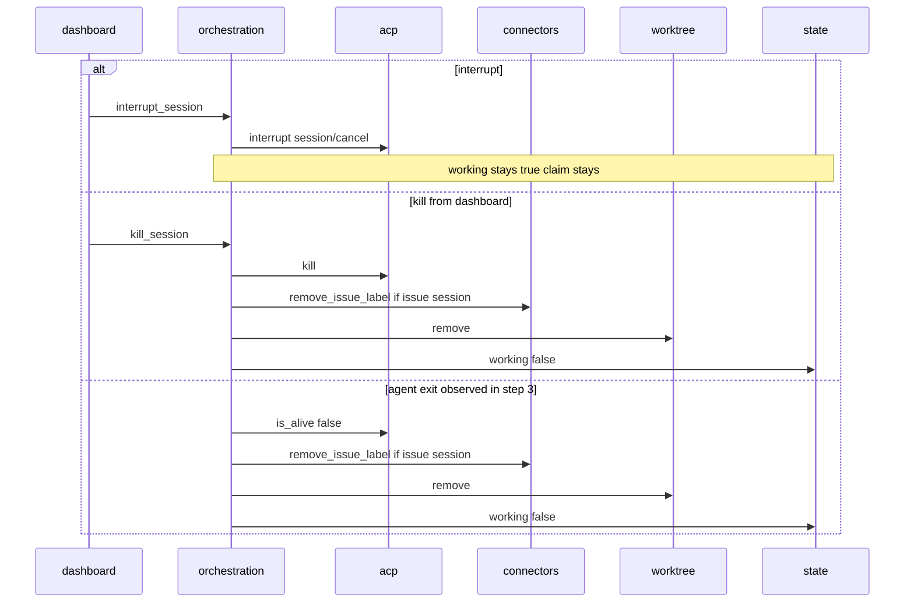
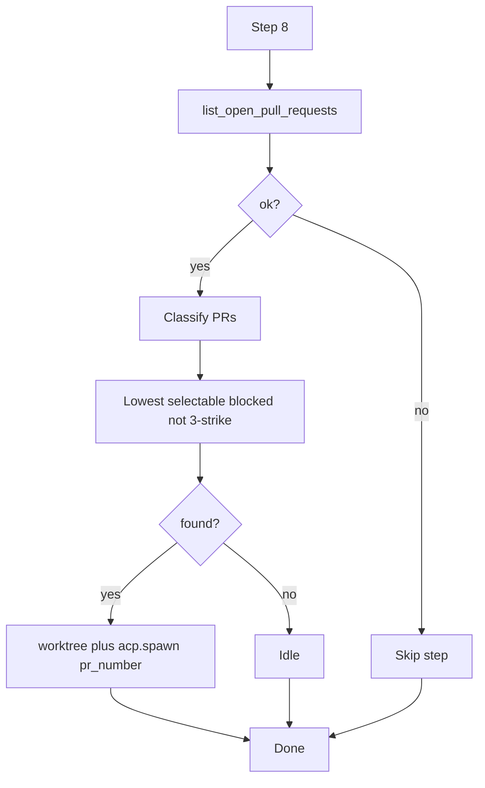
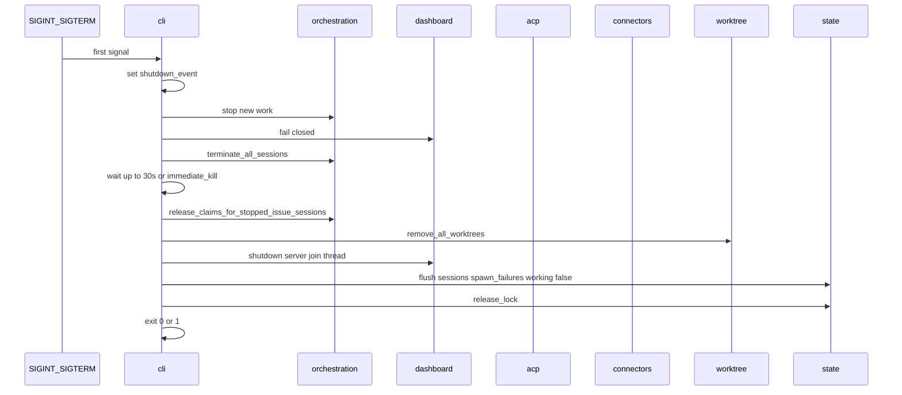

# Sequences

| Features | ADRs |
|----------|------|
| [01](../feature/01-project-bootstrap-and-config.md), [05](../feature/05-agent-orchestration.md)–[08](../feature/08-cli-and-dashboard.md) | [003](../adr/003-1-config-load-and-bootstrap-sequence.md), [007](../adr/007-1-orchestration-cycle-and-claim-session-state-machine.md), [009](../adr/009-1-intake-poll-and-delta.md)–[012](../adr/012-1-dashboard-stack-and-control-api.md) |

Happy paths are diagrams. Unhappy flows, retries, and edge cases are **Notes** under each diagram — keep the diagrams readable.

Component call direction: [components.md](components.md).

---

## 1. Bootstrap

### Notes (bootstrap unhappy)

| Condition | Behavior |
|-----------|----------|
| Not a Git working tree | Exit non-zero; message names path; no prompt |
| Config missing + non-interactive | Exit non-zero; no write |
| Operator rejects scaffold | Exit non-zero; no write |
| Invalid YAML / unknown field / schema fail | Exit non-zero; name field; no default-offer fallback |
| Repo identity unresolved | Exit non-zero; tell operator to set `connector.repo` |
| Live lock holder (pid alive) | Exit non-zero; name `owner/name` |
| Stale lock (pid dead) | Take lock; continue |
| Required privilege missing + interactive | Name each gap; prompt retry/abort; no loop until met or abort |
| Required privilege missing + non-interactive | Exit non-zero; name each gap |
| Warn-only gaps | None in v1 (probe list = required set) |
| Dashboard port in use | Exit non-zero; name `127.0.0.1:port`; no loop |
| Any bootstrap failure | Dashboard never presented as healthy |

Strict step order is ADR [003](../adr/003-1-config-load-and-bootstrap-sequence.md) steps 1–12. Validation before lock; lock before privilege probe and label create.

---

## 2. Poll cycle

Caller (`cli`) holds the **cycle lock** for the entire tick.

**Locked design:** on issue-fetch failure, **skip steps 4–7** entirely (no label mutations, fulfill, or claim-then-spawn). Always run step 3. Step 8 runs only if babysitter is enabled and its PR fetch succeeds (failed PR fetch skips step 8 only).

### Notes (poll unhappy)

| Condition | Behavior |
|-----------|----------|
| Issue fetch fails | Keep last-good snapshot; set in-memory last error; stderr + dashboard; skip 4–7 |
| PR fetch fails (babysitter on) | Skip step 8 only; issue work already done or skipped per above |
| Partial pagination | Treated as fetch failure |
| Session exit during step 3 | Remove claim (issue), remove worktree, mark not working, persist |
| Label remove/add fails mid-cycle | Log; continue cycle; tracker may be stale until next successful reconcile |
| `shutdown_event` set mid-cycle | Finish current step safely if already inside; do not start a new cycle afterward |

---

## 3. Claim-then-spawn and fulfill

### Notes (spawn unhappy)

| Condition | Behavior |
|-----------|----------|
| `add_issue_label` fails | Do not spawn; log; leave issue for later cycle |
| Worktree create fails | Spawn-failure record; claim stays (attempts 1–2); no working session |
| ACP handshake/prompt fails | Remove worktree; spawn-failure record; claim stays through attempts 1–2 |
| Attempt 3 (issue) | Warn stderr; dashboard (`released=true`); `remove_issue_label`; no slot occupied |
| Attempt 3 (babysitter PR) | Skip that PR until not selectable; no issue label |
| Successful spawn after failures | Clear that issue/PR's spawn-failure records |
| Caps full mid-loop | Stop claiming/spawning; step 6 still removes excess unlabeled-fit labels (descending issue number) |

**Fulfill vs new claim:** step 6 only spawns where label already present. Step 7 applies label then spawn. Same agent rule and ascending issue order. Excess labeled issues not assigned: remove label, highest number first.

---

## 4. Agent exit, kill, interrupt

### Notes

| Condition | Behavior |
|-----------|----------|
| Interrupt | No follow-up prompt in v1; pending ACP permissions answered cancelled |
| Babysitter kill/exit | No claim-label change |
| Kill unknown session | HTTP 404 |
| Kill/interrupt after shutdown started | HTTP 503 fail closed |
| Label remove fails on kill/exit | Session still marked not working; label remains for next reconcile; shutdown exit code rules apply only to shutdown batch removals |

---

## 5. Babysitter select-or-idle

Runs as cycle step 8 when `babysitter.enabled` and no working babysitter session.

**Selectable blocked:** open, not draft, `mergeable_state` known and ≠ `clean`.  
**Merge-ready:** `clean` — never selected.  
**Not selectable yet:** draft or `unknown`/missing.

### Notes

| Condition | Behavior |
|-----------|----------|
| Working babysitter already | Do not select or stop; ignore PR state changes including close/merge/clean |
| PR has 3 spawn failures | Skip; clear failures when a later poll finds that PR not selectable |
| Spawn fails | Record failure; retry next cycles until 3; then skip |
| After agent exit | Later cycle may spawn a **new** session id for the PR selected then |

---

## 6. Graceful shutdown

### Notes

| Condition | Behavior |
|-----------|----------|
| Second signal during grace | Set `immediate_kill`; skip remaining wait; kill agent process groups |
| Agents still alive after 30s | `killpg` / kill remaining |
| Label removal fails | Leave label on tracker; contribute to exit 1 |
| Worktree remove fails | Log; do not block shutdown |
| Babysitter sessions | Terminated; no claim-label step |
| Bind never succeeded | Shutdown sequence not used; bootstrap already exited non-zero |

---

## 7. Label reconcile while working (step 4 detail)

When intake fetch succeeded:

| Situation | Action |
|-----------|--------|
| Working session, claim label missing | Re-apply label; do not stop |
| Working session, issue closed / not intake / no longer matches that agent | Kill session, remove label, remove worktree |
| No working session, label absent | Do nothing (do not invent claim from memory) |
| No working session, label present, closed / not intake / no agent / three failures | Remove label |
| Working sessions vs lower numbered labeled issues | Never stop a working session to prefer a lower number |
