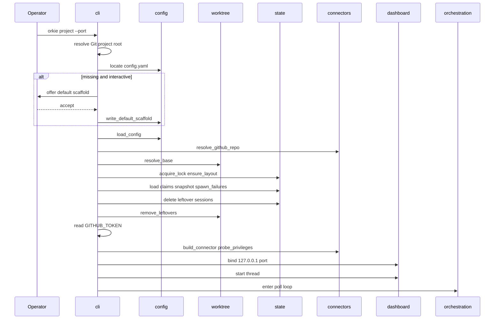
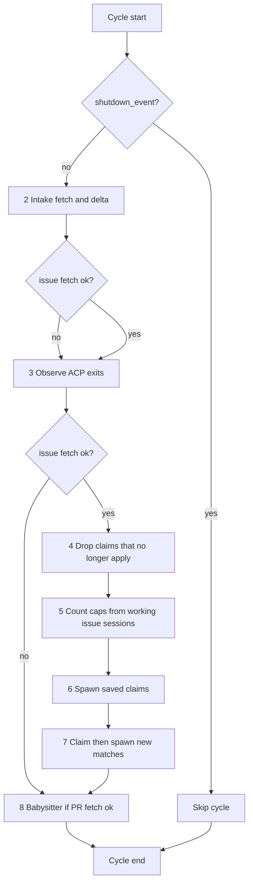
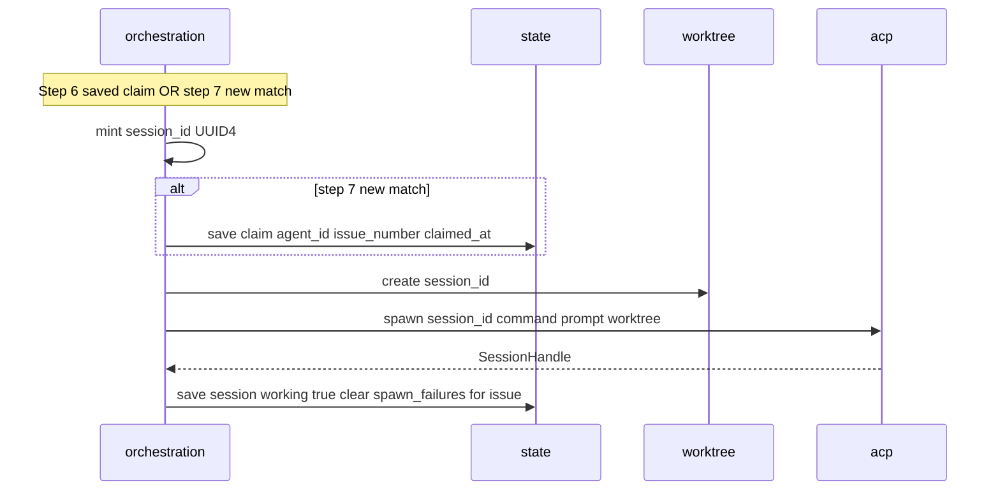
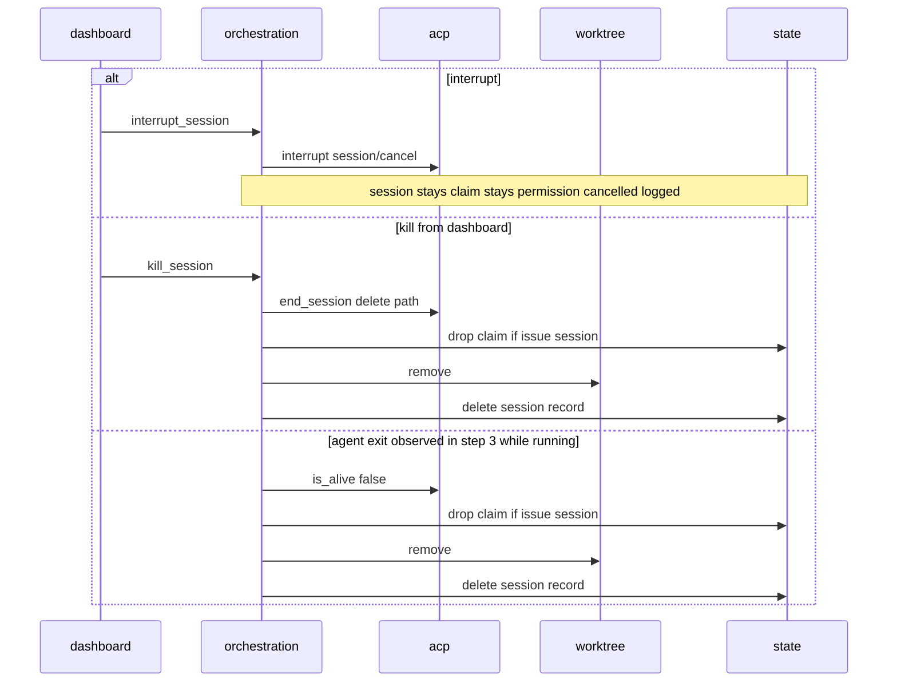
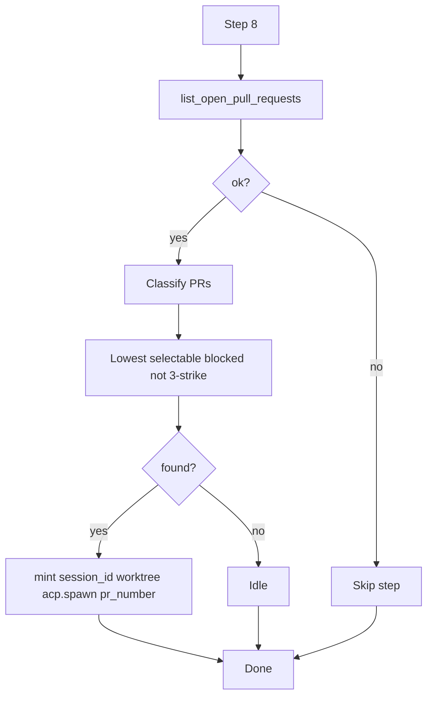
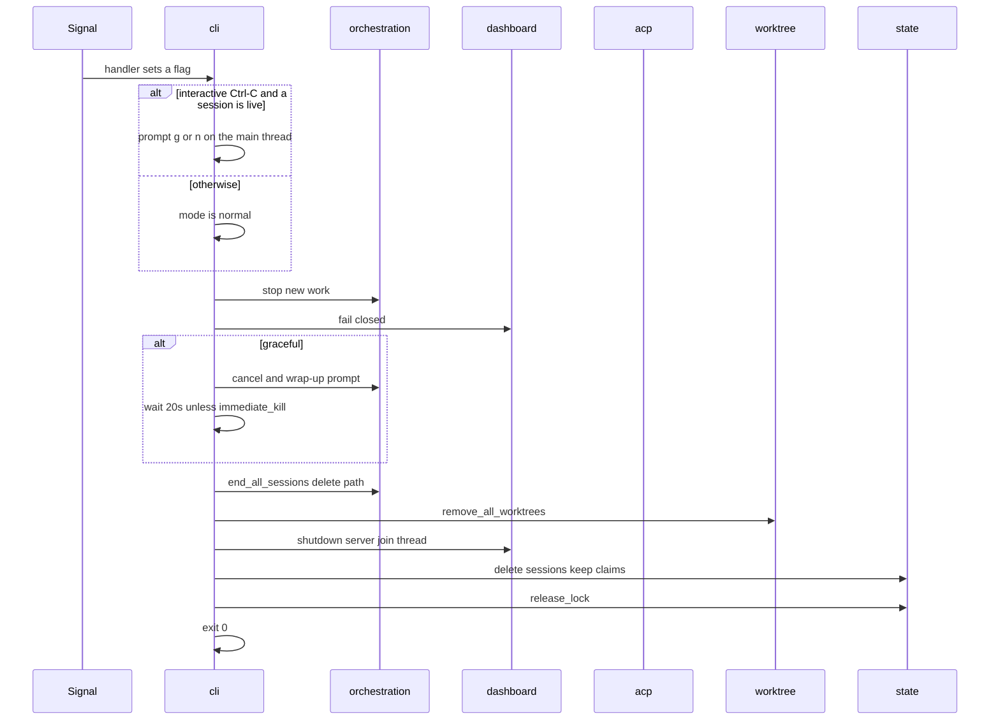

# Sequences

| Features | ADRs |
|----------|------|
| [01](../feature/01-project-bootstrap-and-config.md), [05](../feature/05-agent-orchestration.md)–[08](../feature/08-cli-and-dashboard.md) | [003](../adr/003-3-config-load-and-bootstrap-sequence.md), [007](../adr/007-2-orchestration-cycle-and-claim-session-state-machine.md), [009](../adr/009-2-intake-poll-and-delta.md)–[012](../adr/012-2-dashboard-stack-and-control-api.md) |

Happy paths are diagrams. Unhappy flows, retries, and edge cases are **Notes** under each diagram — keep the diagrams readable.

Component call direction: [components.md](components.md). Dependency direction matches ADR [001](../adr/001-2-process-model-and-module-layout.md): `cli` → bootstrap (`config`, `state`, `connectors`, `worktree`), then the loop `intake` → `orchestration` → `acp` / `worktree`.

---

## 1. Bootstrap

### Notes (bootstrap unhappy)

| Condition | Behavior |
|-----------|----------|
| Not a Git working tree | Exit non-zero; message names path; no prompt |
| Config missing + non-interactive | Exit non-zero; no write |
| Operator rejects scaffold | Exit non-zero; no write |
| Invalid YAML / unknown field / schema fail | Exit non-zero; name field; no default-offer fallback |
| Repo identity unresolved | Exit non-zero; tell operator to set `connector.repo` |
| `resolve_base` fails | Exit non-zero; name the git error |
| Live lock holder (pid alive) | Exit non-zero; name `owner/name` |
| Stale lock (pid dead) or corrupt lock JSON once the flock is held | Rewrite lock contents; continue |
| Corrupt `claims`, `snapshot`, or `spawn_failures` | Exit non-zero; name the file |
| Leftover `sessions` or worktrees | Delete the session file; remove worktrees best-effort. Do not resume ACP sessions and do not reap agent processes |
| Required privilege missing + interactive | Name each gap; prompt retry/abort; no loop until met or abort |
| Required privilege missing + non-interactive | Exit non-zero; name each gap |
| Warn-only gaps | None in v1 (probe list = required set) |
| Dashboard port in use | Exit non-zero; name `127.0.0.1:port`; no loop |
| Any bootstrap failure | Dashboard never presented as healthy |

Strict step order is ADR [003](../adr/003-3-config-load-and-bootstrap-sequence.md) steps 1–12. Validation before lock; lock before the privilege probe. The probe is read-only.

---

## 2. Poll cycle

Caller (`cli`) holds the **cycle lock** for the entire tick.

Persist claim, snapshot, session, and spawn-failure updates **on each mutation** (feature 05 / ADR 007 step 9) — not as a deferred batch after step 8.

**Locked design:** on issue-fetch failure, **skip steps 4–7**. Always run step 3. Step 3 may drop a claim when an issue session exits while Orkie is running and shutdown has not started. Step 8 runs only if the babysitter is enabled and its PR fetch succeeds (a failed PR fetch skips step 8 only). Mutations still persist as they happen.

### Notes (poll unhappy)

| Condition | Behavior |
|-----------|----------|
| Issue fetch fails | Keep last-good snapshot; do not drop or create claims because of the fetch; set in-memory last error; stderr + dashboard; skip 4–7; still run step 3 |
| PR fetch fails (babysitter on) | Skip step 8 only |
| Partial pagination | Treated as fetch failure |
| Session exit during step 3, shutdown not started | Drop the local claim (issue), remove worktree, delete the session record, persist |
| Session exit after `shutdown_event` or interactive shutdown-prompt flag | Do not drop the claim (session cleanup still runs in `shutdown`) |
| `shutdown_event` or prompt flag set mid-cycle | Finish the current step safely without dropping claims on exits; do not start a new cycle afterward |

---

## 3. Claim-then-spawn and fulfill

### Notes (spawn unhappy)

| Condition | Behavior |
|-----------|----------|
| Step 6, stored agent at cap or global cap full | Leave the claim queued. Do not give it to another agent. Do not stop a working session |
| Step 7, no agent has room | Stop. Do not write a claim that cannot spawn on this tick |
| Worktree create fails | Spawn-failure record; claim stays (attempts 1–2); no working session |
| ACP handshake or initial prompt fails | Remove worktree; spawn-failure record; claim stays through attempts 1–2 |
| Attempt 3 (issue) | Warn stderr; `released=true`; drop the local claim; write no fourth row; no slot occupied |
| Attempt 3 (babysitter PR) | Skip that PR until not selectable; no issue claim |
| Successful spawn after failures | Clear that issue or PR's spawn-failure records |
| Issue has any `attempt == 3` row | Do not write a claim and do not spawn |
| Caps full mid-loop | Stop new claims and spawns. Queued claims stay |

**Fulfill vs new claim:** step 6 spawns the agent stored on the claim, ascending issue number. Step 7 writes a claim for the earliest matching agent that has room, then spawns, ascending issue number. A claim dropped in step 4 because the stored agent is missing or no longer matches may be written again in step 7.

---

## 4. Agent exit, kill, interrupt

### Notes

| Condition | Behavior |
|-----------|----------|
| Interrupt | No follow-up prompt in v1; pending ACP permissions answered `cancelled` and logged `permission cancelled` |
| Babysitter kill/exit | No issue-claim change. Kill deletes only that session |
| Kill unknown session | HTTP 404 |
| Kill/interrupt after shutdown started | HTTP 503 fail closed |
| Worktree remove fails | Log; session record still deleted; claim drop still applied for kill and for exit while running |
| Exit after `shutdown_event` or interactive shutdown-prompt flag | Session ends; claim stays |

---

## 5. Babysitter select-or-idle

Runs as cycle step 8 when `babysitter.enabled`, the PR fetch succeeded, and no working babysitter session exists. It still runs when the issue fetch failed.

**Selectable blocked:** open, not draft, `mergeable_state` known and ≠ `clean`.  
**Merge-ready:** `clean` — never selected.  
**Not selectable yet:** draft or `unknown`/missing.

### Notes

| Condition | Behavior |
|-----------|----------|
| Working babysitter already | Do not select or stop; ignore PR state changes including close/merge/clean |
| PR has 3 spawn failures | Skip; clear failures when a later poll finds that PR not selectable |
| Spawn fails | Record failure; retry next cycles until 3; then skip |
| After agent exit | Later cycle may spawn a **new** session id for the PR selected then |
| Issue fetch failed | This step still runs when the PR fetch succeeded |

---

## 6. Shutdown

### Notes

| Condition | Behavior |
|-----------|----------|
| Normal mode | Skip cancel and the 20 second wait. Delete path immediately |
| Graceful mode | `session/cancel`, then the fixed wrap-up prompt from feature 04, then 20 seconds, then the delete path. Idle status does not end the wait. A JSON-RPC error on the wrap-up prompt moves that session to the delete path |
| Second signal during the prompt or the 20 second wait | Set `immediate_kill`; SIGKILL remaining agent process groups; continue cleanup |
| Delete path | `session/delete` when `capabilities.session.delete` was reported, then SIGKILL if the process has not exited within 5 seconds. Without that capability, SIGKILL immediately. The 5 seconds are process exit, not the empty JSON-RPC result |
| Claims | Kept in both modes. An exit after `shutdown_event` or the interactive shutdown-prompt flag does not drop a claim |
| Worktree remove fails | Log; exit stays 0 |
| Babysitter sessions | Ended by the same mode. No issue claim |
| Bind never succeeded | Shutdown sequence not used; bootstrap already exited non-zero |

---

## 7. Claim drop while a session is live (step 4 detail)

When the issue fetch succeeded, scan **every** saved claim against the current `intake_issues` list and loaded config (do not rely only on `delta.left` / `labels_changed`):

| Situation | Action |
|-----------|--------|
| Claim `issue_number` not in current intake set | Delete path for a live session, drop the claim, remove the worktree. Spawn-failure rows stay |
| Claim `agent_id` absent from `config.agents`, or that agent no longer matches the issue | Delete path for a live session, drop the claim. Step 7 may assign a different matching agent unless `attempt == 3` |
| Working session and the claim still matches | Keep the session. Do not stop it to prefer a lower issue number |
| Saved claim, caps full | Leave it queued |
