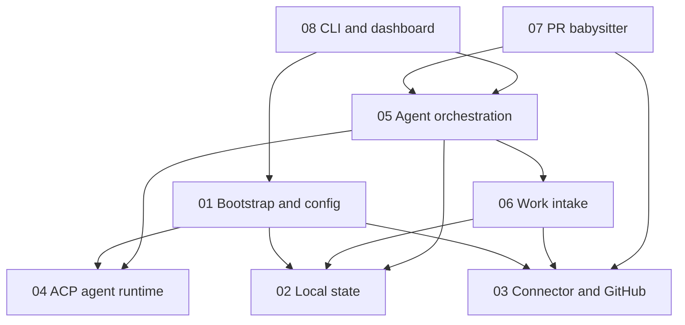

# Orkie Feature Specs

Feature-level product specs for architecture planning. Each file uses the same structure: description, users and use cases, Given/When/Then stories, and acceptance criteria. The config schema and prompt variables live in [01-project-bootstrap-and-config.md](01-project-bootstrap-and-config.md).

## Reading order

1. [01-project-bootstrap-and-config.md](01-project-bootstrap-and-config.md) — `.orkie/config.yaml`, schema, default scaffold, bootstrap
2. [02-local-state.md](02-local-state.md) — per-user `~/.local/share/orkie/<owner>--<repo>/`, claims vs working sessions
3. [03-connector-interface-and-github.md](03-connector-interface-and-github.md) — abstract connector; GitHub; `GITHUB_TOKEN`; repository resolution
4. [04-acp-agent-runtime.md](04-acp-agent-runtime.md) — ACP; OpenCode and Grok Build; session identity
5. [05-agent-orchestration.md](05-agent-orchestration.md) — caps, one issue per session, claim fulfillment
6. [06-work-intake-and-issue-monitoring.md](06-work-intake-and-issue-monitoring.md) — issue labels, poll, delta
7. [07-pr-babysitter.md](07-pr-babysitter.md) — one babysitter, one blocked PR per session
8. [08-cli-and-dashboard.md](08-cli-and-dashboard.md) — CLI, `127.0.0.1:8765`, shutdown, spawn failures

## Shared vocabulary

| Term | Meaning |
|------|---------|
| `.orkie/config.yaml` | Project config. Schema is in feature 01. |
| Config identity | Stable agent or babysitter `id`, plus name, role, command, and prompt. Comes from config. |
| Session identity | Generated id for one ACP spawn. Binds one config identity to exactly one issue or one PR. |
| ACP | Agent Client Protocol. How Orkie talks to agents. |
| Connector | Abstract bridge between local task state and an issue tracker host. |
| Intake issue | Open GitHub issue that is not a pull request and has at least one configured `issue_labels` entry. |
| Claim label | The single tracker label Orkie applies to a claimed issue. Default `orkie:claimed`. It does not encode agent or session id. |
| Claim record | Local record of an issue claim: issue number and config agent id. |
| Working | Whether a session process is actually running. Always false just after process start, until a new spawn. |
| Spawn failure | A failed spawn stored until the next poll. Shown on the dashboard. Does not occupy a session slot or hold a claim. |
| Local state | Per-user runtime data under `~/.local/share/orkie/<owner>--<repo>/`. |
| Session caps | Per-agent limit and a global hard ceiling. Both default to 1. The babysitter does not consume them. |
| Worktree | Dedicated git worktree for one session. Location, base branch, and cleanup are design details. |
| Babysitter | Optional single agent that takes one blocked PR per session. |
| Dashboard | Local web UI at `http://127.0.0.1:8765` for project and session status, spawn failures, logs, interrupt, and kill. |
| Graceful shutdown | SIGINT or SIGTERM: stop new work, terminate agent subprocesses, release claim labels, persist local state, stop the dashboard. Wait at most 30 seconds, then kill remaining agent process groups. Exit 1 if a claim release failed. |
| Merge-ready | Open pull request whose connector mergeable state is `clean`. |

## Dependency sketch

