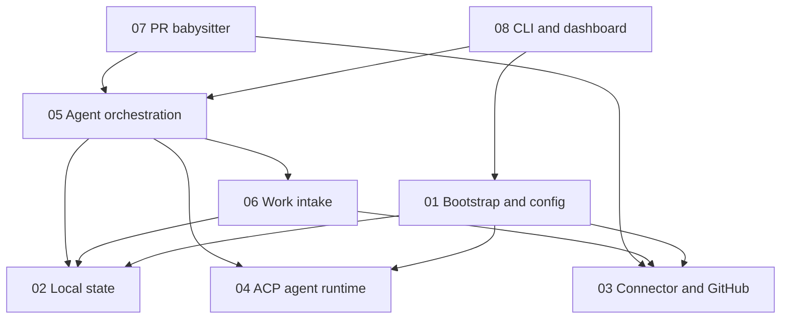

# Feature dependencies

Edges mean **depends on** (consumer → dependency). Keep this graph aligned when a feature starts or stops relying on another.

## By feature

| Feature | Depends on |
|---------|------------|
| [01 Bootstrap and config](01-project-bootstrap-and-config.md) | 02, 03, 04 |
| [02 Local state](02-local-state.md) | — |
| [03 Connector and GitHub](03-connector-interface-and-github.md) | — |
| [04 ACP agent runtime](04-acp-agent-runtime.md) | — |
| [05 Agent orchestration](05-agent-orchestration.md) | 02, 04, 06; babysitter rules in 07 when enabled |
| [06 Work intake](06-work-intake-and-issue-monitoring.md) | 02, 03 |
| [07 PR babysitter](07-pr-babysitter.md) | 03, 05 |
| [08 CLI and dashboard](08-cli-and-dashboard.md) | 01, 05 |
