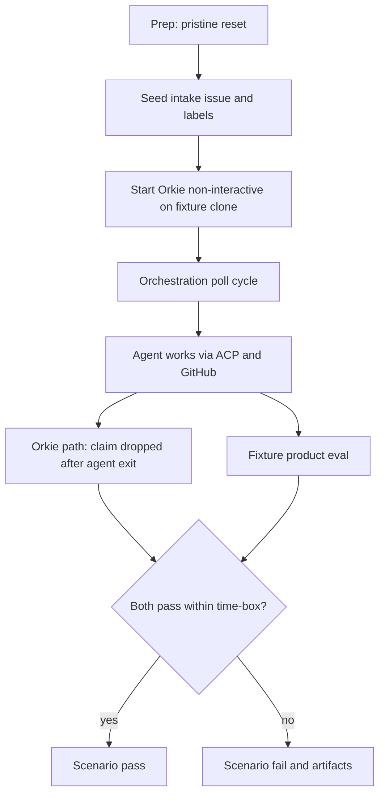

# Integrated acceptance scenario

Live, system-level acceptance of Orkie against a designated GitHub fixture repository. This document defines purpose, methods, preparation, and pass criteria. It does not implement harness scripts; those follow this contract.

Related: offline suite and CI gate in [ADR 002-2](../adr/002-2-tech-stack-and-dependencies.md); claim/spawn/exit in [feature 05](../feature/05-agent-orchestration.md); intake in [feature 06](../feature/06-work-intake-and-issue-monitoring.md); token and privileges in [feature 03](../feature/03-connector-interface-and-github.md).

## Test purpose

Prove Orkie as a whole can drive real development work on a **real GitHub repository** that ships a defined `.orkie` configuration and is exercised with a **real ACP agent**.

| Goal | What “done” means |
|------|-------------------|
| Product score | The fixture repository’s own acceptance criteria / eval (the final product) succeed |
| Orkie path | For each seeded intake issue, Orkie completes **claim → spawn → agent exit → claim drop** while still running |
| Isolation | Each run starts from a **pristine** fixture tip so prior runs cannot contaminate intake or git history |

This tier validates end-to-end orchestration and agent progress. It does **not** replace the offline pytest suite or the ≥80% coverage gate.

### Out of scope (v1 of this scenario)

- PR babysitter lifecycle and merge orchestration
- Dashboard UI checks
- Multi-agent concurrency stress (unless the fixture’s own product story defines multiple agents)
- Default CI / coverage measurement

## Test methods

Black-box evaluation in a live environment. The harness does not inject fakes at the `Connector` or `AcpClient` boundaries.

### Environment

| Input | Requirement |
|-------|-------------|
| Target | A designated GitHub test repository (or disposable fork) used only for this scenario |
| Token | `GITHUB_TOKEN` with Orkie’s required privileges for the fixture config ([feature 03](../feature/03-connector-interface-and-github.md#required-privileges)), plus privileges the **harness** needs for pristine reset and seeding (force-push to `main`, create/delete or otherwise clear issues, manage labels) |
| Agent | ACP-compatible command from the fixture’s `.orkie/config.yaml`, available on the harness host |
| Time-box | Wall-clock limit for the Orkie run; expiry is a scenario failure |
| Mode | Orkie started **non-interactive** against a local clone of the fixture at the pristine tip |

### Driver interface

The harness is a set of preparation, run, and eval scripts (or equivalent entrypoints). Contract:

| Phase | Responsibility |
|-------|----------------|
| Prepare | Authenticate; force-reset remote `main` to the pristine tip; clear issues; clear local Orkie state for that repo; seed intake; verify clone matches tip |
| Run | Start Orkie non-interactive on the clone; wait until hybrid path and product eval can be judged, or until time-box; shut Orkie down cleanly |
| Evaluate | Confirm Orkie-path outcomes from local state (and GitHub as needed); run the fixture’s documented product eval; emit pass/fail |

Fail closed if preparation cannot complete. Do not start Orkie against a dirty target.

### Observation

| Signal | Role |
|--------|------|
| Fixture product eval exit code / reported AC | Primary **product** score |
| Local claims, sessions, worktrees under the test `state_root` | Primary **Orkie-path** evidence; also diagnostic artifacts |
| GitHub issue/label state after the run | Supporting evidence; seed and product AC may depend on it |
| Orkie logs | Diagnostics only; not the product score |

This scenario is **not** part of the default pytest suite. A future marker or separate entrypoint may wrap the harness; ADR 002 offline rules stay unchanged until that ADR is updated.

## Test preparation

Every run must restore the fixture to a **pristine** state before seeding and starting Orkie.

### Pristine tip

The fixture owns a known pristine tip: a tag or pinned SHA that represents the repository before any acceptance-run mutations. Preparation force-resets remote `main` to that tip. Local clone must match that tip after reset. This is destructive and must run only against the designated test repository.

### Preparation steps

| Step | Requirement |
|------|-------------|
| Authenticate | Token usable for GitHub API and git operations required below |
| Force-reset `main` | Reset remote `main` to the fixture’s pristine tip; local clone matches that tip |
| Delete issues | Remove all issues on the target repo so no leftover intake can be claimed. Prefer hard delete via API when available. If the host cannot hard-delete, use a documented fallback that leaves **no open intake-eligible issues** and clears labels the fixture relies on for intake |
| Clear local Orkie state | Empty or recreate the state directory for that `owner--repo` (claims, sessions, worktrees, spawn failures, lock) so prior runs do not leak |
| Seed | Create exactly the intake issue(s) and labels the fixture expects; issue body and product acceptance criteria live in the fixture |
| Config | Fixture ships `.orkie/config.yaml` (and any `prompt_file` assets) at the pristine tip; Orkie under test starts against that clone |
| Agent | ACP command from config is on PATH, or the fixture config uses an absolute path valid on the harness host |

### Fail closed

If force-reset of `main` fails, issue cleanup fails, local state cannot be cleared, or the clone does not match the pristine tip after reset, preparation fails and the scenario does **not** start Orkie.

## Test acceptance criteria

**Pass** only when **all** of the following hold within the time-box:

1. **Pristine prep succeeded** — `main` is at the expected pristine tip before seed; no pre-existing intake-eligible issues remain after cleanup; local Orkie state for the target repo is clean; seed issues and labels are applied as the fixture documents.
2. **Orkie hybrid path** — for each seeded intake issue: Orkie wrote a local claim, spawned a working session, the agent exited while Orkie was still running and shutdown had not started, Orkie dropped that issue’s local claim, and the session worktree was removed (per [feature 05](../feature/05-agent-orchestration.md)).
3. **Fixture product eval** — the fixture’s documented acceptance criteria / eval command exits success. This is the product score.
4. **Clean stop** — Orkie shuts down without interactive prompts; no second live Orkie process for the same GitHub repository conflicts during the run.
5. **No forbidden side effects** — secrets are not written under `.orkie/` or state logs; mutations stay on the designated test repository.

**Fail** when any of the following occur:

- Preparation reset or cleanup fails
- Time-box expires before both Orkie-path and product-eval success
- Spawn reaches the three-strike drop for a seeded issue without product success
- Orkie-path criteria fail for any seeded issue
- Fixture product eval fails
- Interactive prompt is required, or a process-lock conflict aborts the run
- Work or credentials escape the designated test repository / env contract

## Harness notes (non-normative for product features)

- Scripts that implement preparation **must** be able to force-reset `main` and clear issues; that capability is part of this scenario’s prep contract, not of Orkie’s runtime feature set.
- The fixture repository documents its product eval command and the shape of seeded issues; Orkie’s feature specs do not own that product AC.
- Collect state directory and logs on failure for diagnosis; they do not override a failed product eval.
